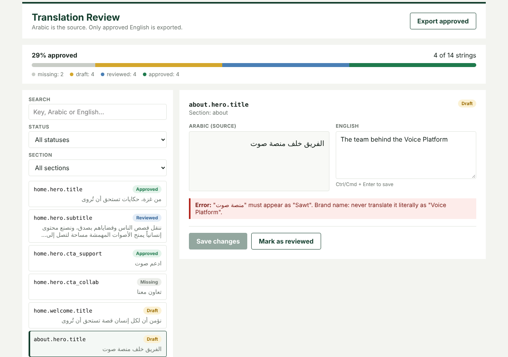

# Translation Review

Arabic and English, side by side, with a review gate in front of production. Arabic is the source of truth. English moves through **draft → reviewed → approved**. Glossary mistakes and broken placeholders block that path. Only approved English is exported.



Machine drafts and rushed edits ship the same three failures: a brand name translated literally, a `:name` or `{amount}` placeholder dropped so a page breaks, and a leftover value such as `admin@admin.com` left in a title. This app stops those before they reach a language file.

## Rules

These are enforced in plain TypeScript, in the UI and again on the API. A client cannot skip them by calling the server directly.

| Rule | What it means |
|---|---|
| Status is a table | `draft` may become `reviewed`. `reviewed` may become `approved` or return to `draft`. `approved` may return to `draft`. Nothing else is allowed. |
| An edit voids sign-off | Any change to the English sends the string back to `draft`, or to `missing` if the English is cleared. |
| Glossary is blocking | If the Arabic contains a glossary term, the English must contain that term’s required translation. Matching ignores Arabic diacritics. |
| Placeholders are blocking | Laravel `:name` and `{name}` / `{{ name }}` tokens in the Arabic must appear unchanged in the English. Extra placeholders are also an error. |
| Length is a warning | A large gap in word count or length is shown. It does not block review. |
| Import resets approval | If an import changes the Arabic of a string that was already approved, that string returns to `draft`. Imported strings cannot arrive already reviewed or approved. |
| People are not overwritten | Automatic translation fills empty English only. Text a person has written is left alone unless they press Auto-translate themselves. |
| Export is the gate | The export contains every Arabic string and only the English strings whose status is `approved`. |

## What you can do in the dashboard

- Read Arabic right-to-left and English left-to-right in one view.
- Search and filter by key, Arabic, English, status, and section. Arabic search is normalised.
- Add strings, import JSON, delete with confirmation, and edit the glossary.
- Import a flat file, a nested Laravel language file, or `{ ar, en }`.
- Translate a new Arabic string on create, or translate every string that still has no English. The result is saved as a machine draft.
- After you stop typing, a meaning check says whether the English matches the Arabic: accurate, possible mistake, or unsure. It can suggest a fix. A person still has to approve.
- Save is optimistic and rolls back if the server rejects the write, so the screen never keeps a change that was not stored.

Keyboard save is Ctrl or Cmd + Enter. Controls are labelled. The issue list is an `aria-live` region, the selected row is `aria-current`, and the progress bar exposes its value.

## Layout

```
src/
  domain/       Workflow, checks, filters, import, export. No React. Unit-tested.
  data/         TranslationApi and TranslationService, plus local and HTTP adapters.
  state/        Reducer and provider. Orchestration only. Rules stay in domain/.
  components/   Presentational UI.
server/
  src/          HTTP API. Same domain rules. Holds the model key.
laravel/      Optional AI controller for an existing Laravel app.
```

The UI never knows where data lives. With no environment variables it uses `localStorage` and a small demo phrasebook. Set `VITE_API_BASE_URL` and the same screens talk to `server/` instead. Swap the adapters in `src/main.tsx` if you want that wiring written out by hand.

Updates are immutable. Tests inject the clock, so timestamps do not depend on the wall clock.

## Run the dashboard

```bash
npm install
npm run dev
```

Open the local URL Vite prints. In this mode your data stays in this browser and translation only knows a handful of phrases. That mode is there to show the workflow, not to translate real copy.

```bash
npm test
npm run test:coverage
npm run typecheck
npm run build
```

## Run it with the API

The API is the `server/` program in this repo. It stores the strings, repeats the review rules, and calls the model. You do not need a hosted machine to use it.

1. Copy `server/.env.example` to `server/.env`.
2. Set `ANTHROPIC_API_KEY` to a key from [console.anthropic.com](https://console.anthropic.com/settings/keys). The account needs credits under Plans & billing.
3. Leave `ANTHROPIC_MODEL=claude-sonnet-5-5`, or replace it with another model id your key can call. It is a model name, not a second secret.
4. Set `API_TOKEN` if anything other than your own machine can open the port. Leave it empty on your own computer.
5. Copy `.env.example` to `.env.local` and set:

```
VITE_API_BASE_URL=http://localhost:8787/api
```

If you set `API_TOKEN`, set the same value as `VITE_API_TOKEN`. That token is visible in the browser. It only stops strangers from calling your API. The model key stays in `server/.env` and is never read by Vite.

Two terminals, from the repo root:

```bash
npm run server    # http://localhost:8787
npm run dev       # dashboard. Restart it after changing .env.local
```

`CORS_ORIGIN` must include the origin Vite prints. The example allows `http://localhost:5173` and `http://localhost:5174`. A successful start prints `AI model: claude-sonnet-5-5`.

`laravel/SETUP.md` is the same AI contract as a controller you can drop into an existing Laravel app. Persistence for that setup is not included. `server/` is the full implementation.

## API

Base URL in development: `http://localhost:8787/api`.

When `API_TOKEN` is set, every route except health requires `Authorization: Bearer <token>`.

| Method | Path | Body / response |
|---|---|---|
| GET | `/health` | `{ ok: true, ai: boolean }` |
| GET | `/translations` | `{ items: TranslationItem[], glossary: GlossaryTerm[] }` |
| PUT | `/translations/{id}` | `TranslationItem`. Create or update. The id in the body must match the URL. |
| DELETE | `/translations/{id}` | Empty. |
| PUT | `/translations` | `TranslationItem[]`. Replace all. Used by import. |
| PUT | `/glossary` | `GlossaryTerm[]` |
| POST | `/ai/translate` | `{ text, glossary }` → `{ translation }` |
| POST | `/ai/review` | `{ ar, en, glossary }` → `{ verdict, summary, suggestion? }` |

`verdict` is `correct`, `problem`, or `unsure`. A malformed model reply is an error, never a guessed answer. A translation that drops a placeholder is rejected and nothing is saved. Glossary and placeholder errors are answered by the same checks as the UI and do not call the model.

Model calls are limited to 30 per client per minute. Rule-only reviews do not count toward that limit.

## How the model is called

The browser posts the Arabic, the English, and the glossary. The server builds the prompt.

- The API key never leaves the server. Upstream errors are logged as a status and a short message. The key is not logged.
- Source text, the translation, and glossary terms are wrapped in tags. Angle brackets inside that text are replaced so the text cannot close the tag and act as an instruction.
- The model must reply with one JSON object. Prose around the object is stripped. A reply that is not the expected shape is a 502.
- The meaning check in the browser is cached per Arabic and English pair. A reply for text that has since changed is dropped.
- The check starts 0.7 seconds after typing stops. One translation is one short request.

## Verification

100 tests across five layers: domain rules and the importer (44), the translator adapters (9), the reducer (5), the full UI through Testing Library (26), and the API (16). The API tests cover the workflow table, import, auth, prompt fencing, a dropped placeholder, a bad model reply, and the rate limit.

CI runs typecheck, tests with coverage, and the production build on Node 20 and 22.

Changing the workflow table without updating the tests fails the suite. That is intentional.

## Stack

React 18, TypeScript in strict mode, Vite, Vitest, and a Node HTTP API. No UI framework and no model SDK. The model is one `fetch` behind a `LanguageModel` interface, so the vendor can change without touching a component.
